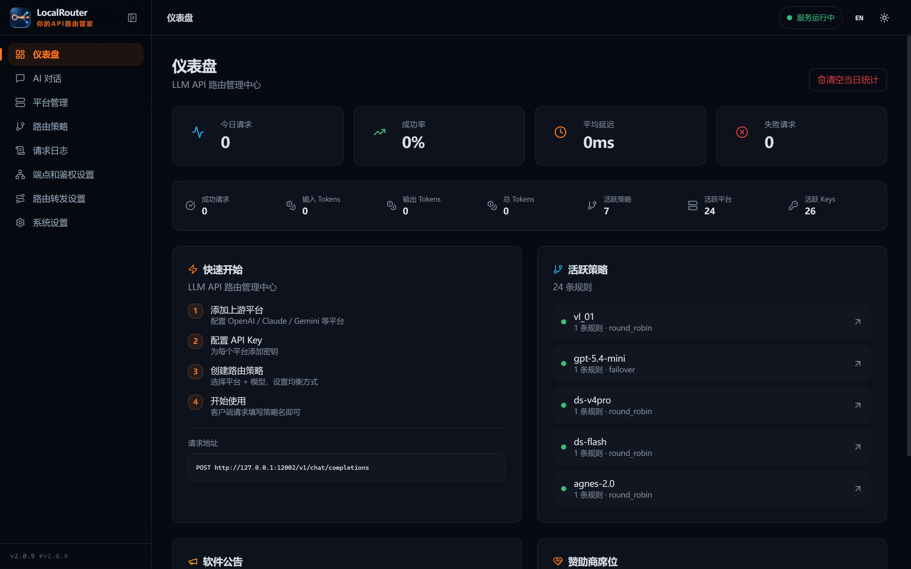
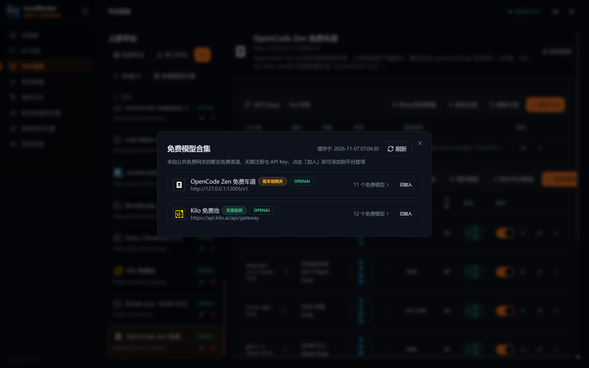
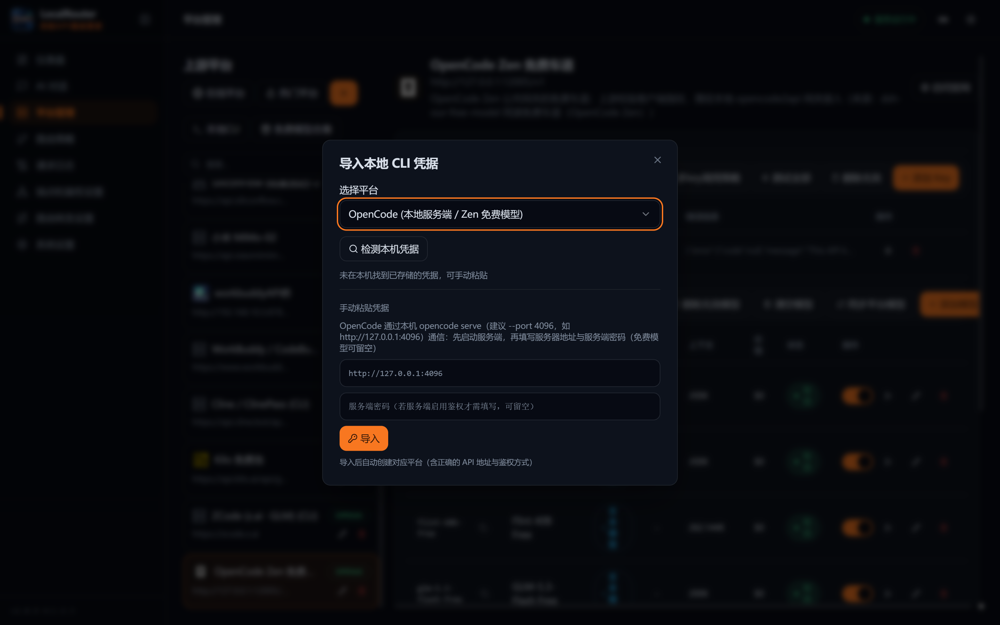
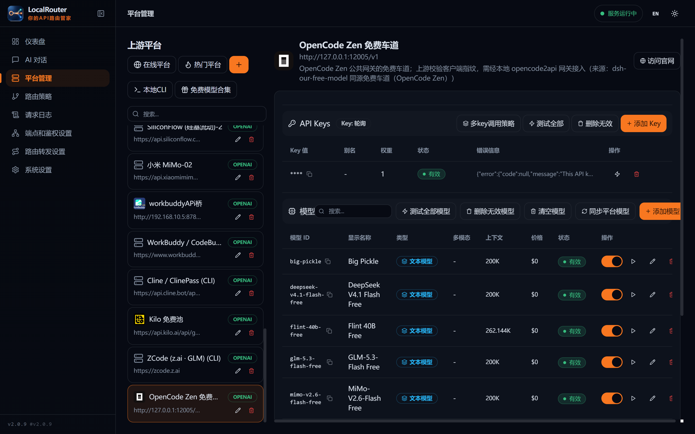
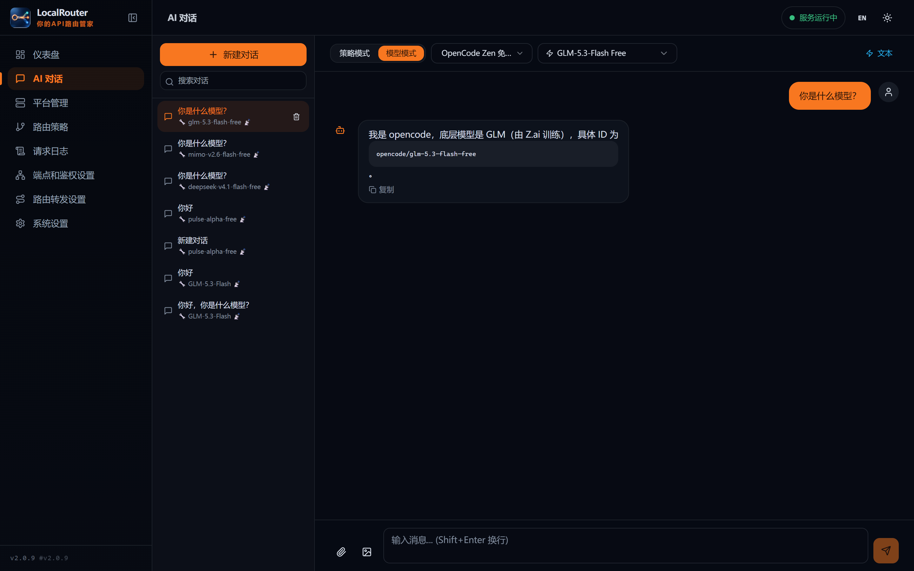
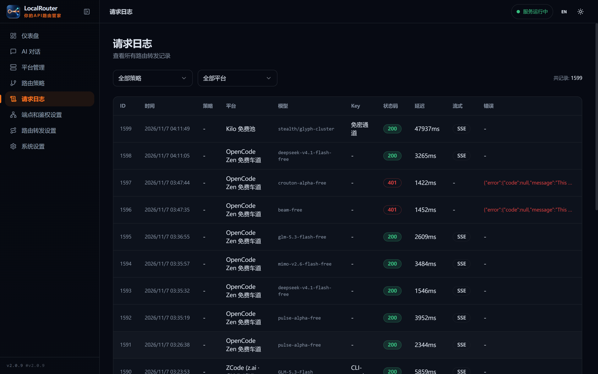
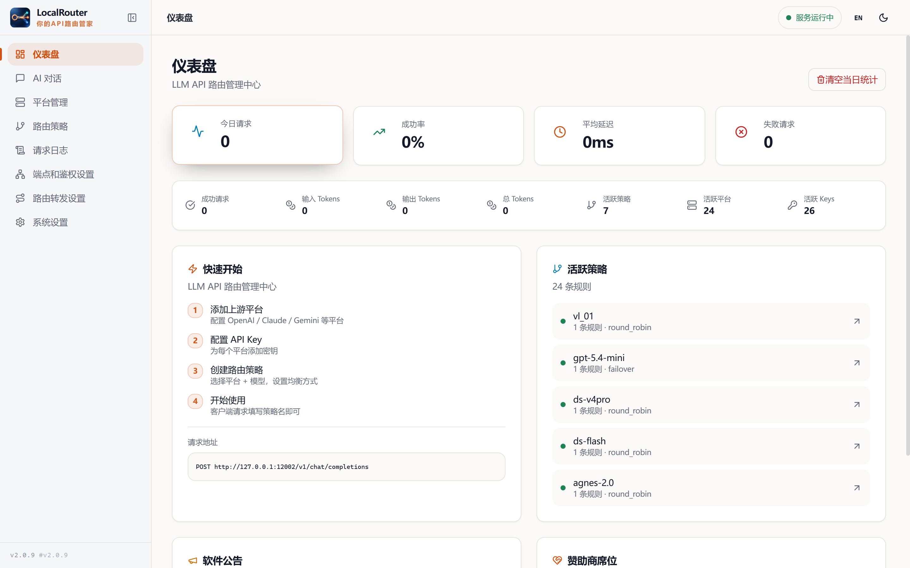

# LocalRouter

<p align="center">
  
</p>

> **Your Local LLM API Routing Manager** | 你的本地 API 路由管家

> **English** | [中文](README_ZH.md)

[](https://python.org)
[](https://fastapi.tiangolo.com)
[](https://react.dev)
[](https://typescriptlang.org)
[](LICENSE)

<p align="center">
  
</p>

---

## Two Signature Capabilities

### 🆓 Free-Model Aggregation — Start routing at $0

The **Free Model Collection** keeps track of public free gateway channels (OpenCode Zen
free lane, Kilo free pool, …). One click on **Join** creates the provider, imports every
free model (**20+ models at $0** today) — no registration, no API key required:

<p align="center">
  
</p>

- **Zero barrier**: anonymous public channels; joining auto-creates the provider with keys and models
- **Fully integrated**: free channels live in the same strategy / load-balancing / monitoring system as your paid keys — use them as a fallback tier, a degradation tier, or just free capacity
- **Gateway guidance**: channels that need a local gateway (e.g. OpenCode Zen) get the gateway URL pre-filled, or read automatically from `config.json`
- **Cloud-synced**: the channel list is maintained upstream with a cache timestamp and one-click refresh

### 🧩 Local CLI Reverse Proxy — Turn CLI free tiers into an OpenAI API

Beyond standard API keys, LocalRouter ships a **local CLI credential import wizard**:
detect / paste / browser-auth the credentials, **renew them automatically**, and translate
the CLI's **private protocol into standard OpenAI format** — any OpenAI SDK client can
now call the models behind those CLIs:

<p align="center">
  
</p>

- Import wizard covers **OpenCode / Cline / ZCode / WorkBuddy / Amazon Q / Antigravity / Trae** and more
- **OpenCode**: relays to a local `opencode serve` runtime, collecting output incrementally over SSE; the private session/message protocol is fully adapted
- **Cline**: browser authorization + automatic renewal, talking to its cloud with official client fingerprint impersonation
- See [Local CLI Reverse Proxy](#local-cli-reverse-proxy) below for implementation details and measured findings

---

## Highlights

- **⚡ Local One-Stop Management** — Centrally manage all your upstream AI providers (OpenAI, Anthropic, Google Gemini, DeepSeek, and 65+ more) in one local dashboard
- **🔄 Multi-Strategy Intelligent Routing** — 5 load-balancing strategies (Round Robin, Weighted, Random, Failover, Priority) with automatic failover
- **🔑 Multi-Key Load Balancing** — Distribute requests across multiple API keys per provider with RPM/count threshold switching
- **🤖 Multi-Model Auto Scheduling** — Automatically route to the best available model based on strategy rules
- **🛡️ Protocol Auto-Conversion** — Seamless conversion between OpenAI, Claude, and Gemini formats — use any SDK to call any model
- **🎨 Midnight Routing UI** — A fresh deep-navy + ember-orange interface with dark/light themes, bilingual UI, and responsive layout

## UI Tour

| Providers (keys / models / $0 free models) | AI Chat |
|:---:|:---:|
|  |  |
| **Request Logs** | **Light Theme** |
|  |  |

---

## Why LocalRouter?

Managing multiple LLM providers is painful. Each has its own API format, billing, and rate limits. You need multiple API keys, multiple SDKs, and manual failover handling.

**LocalRouter solves this** by providing a single OpenAI-compatible endpoint that handles:

| Problem | Solution |
|---------|----------|
| Multiple provider SDKs | Single OpenAI-compatible API |
| API key sprawl | Centralized key management with encryption |
| Provider outages | Automatic failover between providers |
| Rate limiting | Multi-key rotation with intelligent switching |
| Format differences | Auto-convert between OpenAI/Claude/Gemini |
| Model discoverability | One-click upstream sync + free-model aggregation + built-in model database |
| Tight budget | 🆓 Join free channels in one click — wire things up before paying |

---

## 🌐 LAN Network Advantages

LocalRouter is designed for **local area network (LAN)** deployment from day one. Once you enable LAN access in Settings, every device on your network benefits:

| Advantage | Description |
|-----------|-------------|
| **💰 Cost Sharing** | One API key subscription serves your entire team — no per-device licensing |
| **🔑 Centralized Key Management** | Add/rotate API keys in one place, all LAN devices use them automatically |
| **📋 Unified Strategy Control** | Define routing rules once, all team members share the same intelligent routing |
| **⚡ Zero Latency Overhead** | Local network forwarding adds <1ms — no cloud relay delays |
| **🔒 Data Privacy** | All API requests stay within your LAN; no data passes through external gateways |
| **🖥️ Cross-Platform** | Windows, macOS, Linux, iOS, Android — any device with an HTTP client works |
| **🔌 Plug-and-Play** | Compatible with all OpenAI SDK clients — Cursor, ChatBox, CherryStudio, Open WebUI |

**Typical use cases:**
- Team shares one set of API keys across all workstations
- Mobile devices access LLM APIs without installing SDKs
- IoT devices integrate AI capabilities through a local endpoint
- CI/CD pipelines use the same routing strategy as development

---

## Features

### Provider Management
- Structured management of upstream providers (name, protocol, base URL, icon) with one-click icon search
- 65+ hot provider templates for instant setup; online provider catalog import
- Enable/disable providers individually

### API Key Management
- Per-provider API key grouping with aliases, weights, and batch import
- Key health detection (active/inactive/untested), batch test, batch delete invalid keys
- **Multi-key policies**: round robin / random / failover / RPM threshold / count threshold
- **Encrypted storage** — keys encrypted at rest using Fernet symmetric encryption

### Model Management
- Per-provider model management (type / multimodal / context window / pricing)
- One-click sync from upstream API with intelligent parameter detection; select-all / invert / batch add
- Built-in **known models database** with 100+ pre-configured models
- Model connectivity testing, batch testing, automatic degradation

### Routing Strategies
| Strategy | Description |
|----------|-------------|
| **Round Robin** | Sequential rule rotation |
| **Weighted** | Weight-proportional distribution |
| **Random** | Random rule selection |
| **Failover** | Priority-based, switch on failure |
| **Priority** | Always use highest priority |

### Protocol Support
- **OpenAI** — Native compatibility (GPT, o1, o3 series, DALL-E, TTS, Whisper)
- **Anthropic Claude** — Automatic format conversion
- **Google Gemini** — Automatic format conversion
- **Custom** — Any OpenAI-compatible endpoint

### Observability
- **Dashboard** — Today's request stats, success rate, latency, token usage, live refresh
- **Request Logs** — Full request history with strategy/provider filters and error details
- **Strategy Testing** — Test routing chains before production use

### Settings
- **Dark / Light / System** theme (dark by default)
- **Bilingual UI** — Chinese and English
- Backup & restore (manual / scheduled / upload restore), one-click GitHub update

---

## Local CLI Reverse Proxy

Beyond standard API keys, LocalRouter can import credentials from **local / third-party CLI
tools**, auto-renew them, and translate their private protocols into OpenAI-compatible format.
Forwarding adapters are complete for **OpenCode** and **Cline**.

| Platform | Connection | Needs local process |
|----------|------------|---------------------|
| **OpenCode** | Relay — forwards to local `opencode serve` | **Yes** |
| **Cline** | Direct — forwards to `https://api.cline.bot/api/v1` | No |

> The two use "CLI" differently: OpenCode actually drives the CLI runtime on your machine,
> while Cline only means **the credential comes from a Cline account** — requests go straight
> to its cloud, with no local process involved.

### OpenCode (local runtime relay)

1. Install the CLI: `npm install -g opencode-ai`
2. Start the server:
   ```bash
   opencode serve --port 4096 --hostname 127.0.0.1
   ```
   > Port note: examples use **4096**. OpenCode's usual port 10001 is often taken by other
   > software (e.g. Xiaomi PC Manager on Windows), which breaks the connection.
3. Go to **Providers → Local CLI**, pick **OpenCode**, click **Detect local credentials**
   for automatic import, or fill in the server URL and password manually (leave the
   password empty when the server has no auth)
4. Click **Test** to verify, then **Sync Provider Models** to pull the free models

Implementation notes:

- Chat uses OpenCode's private **session / message** protocol (not an OpenAI endpoint)
- Output is collected incrementally over the **SSE event stream** `GET /global/event`
  (no polling); it falls back to polling automatically if the stream is unavailable
- Event payloads are nested as `{payload:{type,properties}}` and must be unwrapped;
  `type=="sync"` events are duplicate deliveries and are de-duplicated

### Cline (direct to cloud + client impersonation)

1. Go to the **Local CLI** wizard, pick **Cline**, click **Open browser authorization**
   to sign in; the credential is saved and renewed automatically
2. Click **Sync Provider Models** to pull the free models (e.g. `cline-free/deepseek-v4.1-flash`)

Implementation notes (Cline is not a standard OpenAI endpoint — it must speak the official
plugin's private protocol):

- Endpoint `https://api.cline.bot/api/v1/chat/completions`, auth `Bearer workos:<accessToken>`
- Must send Cline client fingerprint headers (`User-Agent: Cline/3.0.47`,
  `X-CLIENT-TYPE: cline-sdk`, `X-PLATFORM: terminal`, …), otherwise free models return
  `403 only available via Cline product surfaces`
- Sending `max_tokens` makes free models return 500, so it is stripped automatically
- Non-streaming requests on the free channel get rate-limited, so the upstream is forced to
  stream and the result is re-aggregated

### Tool calling (function calling)

| Platform | Support |
|----------|---------|
| **Cline** | ✅ Client `tools` are passed through; standard `tool_calls` returned |
| **OpenCode** | ⚠️ Only its built-in tools (bash / websearch, executed server-side); standard function calling is unreliable on the free tier |

Why OpenCode is limited (measured): its models ship with 27 built-in tools and ignore
externally injected tool descriptions; disabling those tools trips the free-tier guard —
mismatched names flood `session.error` and stall the request, and disabling them all makes the
upstream return `403 OpenCode's free tier can only be used from within OpenCode`.
The bridge is preserved and can be enabled explicitly via `OpenCodeClient(bridge_tools=True)`
for self-hosted paid-model setups.

---

## Architecture

```
Client (OpenAI SDK / Third-party App)
  |
  | POST /v1/chat/completions (model="strategy-name")
  v
[proxy.py] -- Resolve strategy by model name
  |
  v
[balancer.py] -- Select routing rule + API key
  |                (5 LB strategies / 3 key strategies)
  v
[forwarder.py] -- Protocol adaptation + upstream request
  |                (OpenAI / Claude / Gemini / local CLI private protocols / free gateways)
  v
[protocol_adapter.py] -- Optional output format conversion
  |
  v
[stream_handler.py] -- SSE streaming handling
  |
  v
Client <--- Standard OpenAI format response
```

---

## Quick Start

### Prerequisites

- Python 3.10+
- Node.js 18+

### 1. Clone & Initialize

```bash
git clone https://github.com/licorxj/QM-LocalRouter.git
cd QM-LocalRouter

# Initialize database (creates venv, installs deps, creates database)
cd scripts
python init_db.py        # cross-platform Python script
# or: ./init_db.sh       # Linux/macOS
# or: init_db.bat        # Windows
cd ..
```

### 2. Start Services

**Option A: Using management scripts (recommended)**

```bash
# Linux/macOS
chmod +x scripts/manage.sh
./scripts/manage.sh start

# Windows
scripts\manage.bat start
```

**Option B: Manual start**

```bash
# Terminal 1 - Backend
cd backend
venv\Scripts\activate        # Windows
# source venv/bin/activate   # Linux/macOS
uvicorn app.main:app --host 0.0.0.0 --port 12002

# Terminal 2 - Frontend
cd frontend
npm install
npm run dev
```

### 3. Use

1. Open **http://localhost:12001** in your browser
2. **Zero-cost start**: go to **Providers → Free Model Collection**, join a free channel
   and instantly get 20+ $0 models
3. Or click **+** to add your own provider (use **Hot Providers** templates) and add an API key
4. Add models — manually, via **Sync**, or the **Sync Provider Models** dialog
5. Go to **Strategies**, create a strategy with routing rules
6. In your client, set `base_url` to `http://localhost:12002/v1` and `model` to your strategy name

---

## Tech Stack

| Layer | Technology | Description |
|-------|-----------|-------------|
| Frontend | React 18 + TypeScript + Vite 5 | SPA with fast HMR |
| UI | Tailwind CSS 3 + Radix UI | "Midnight Routing" design system, dark/light themes |
| State | Zustand + TanStack Query 5 | Lightweight state + server cache |
| i18n | Custom React Context | Chinese / English |
| Backend | Python 3.10+ + FastAPI + uvicorn | Async high-performance API |
| Database | SQLite + SQLAlchemy 2.0 (async) | Zero-config local storage |
| Encryption | cryptography (Fernet) | Encrypted API key storage |
| HTTP | httpx (async) | Upstream API forwarding |

---

## API Overview

All proxy endpoints are at `/v1/` and are fully compatible with the OpenAI SDK.

The response format is decided by the **endpoint** you call (no global switch):

| Endpoint | Client format |
|----------|---------------|
| `POST /v1/chat/completions` | OpenAI Chat Completions (streaming + non-streaming) |
| `POST /v1/responses` | OpenAI Responses API (Codex/Cline clients, stateless) |
| `POST /v1/messages` | Anthropic Messages API (Claude SDK, base_url = `/v1`) |
| `POST /v1beta/models/{model}:generateContent` | Gemini GenerateContent (Gemini SDK, base_url = `/v1beta`) |
| `GET /v1beta/models` | Gemini-style model list |

The backend converts each format to the upstream protocol automatically; when
client and upstream already speak the same protocol the request is forwarded
untouched.

| Endpoint | Description |
|----------|-------------|
| `POST /v1/chat/completions` | Chat completions (streaming + non-streaming) |
| `POST /v1/responses` | Responses API (Codex/Cline clients, streaming + non-streaming, stateless) |
| `POST /v1/completions` | Text completions |
| `POST /v1/embeddings` | Embeddings proxy |
| `POST /v1/images/generations` | Image generation proxy |
| `POST /v1/audio/speech` | Text-to-speech proxy |
| `POST /v1/videos` | Video generation proxy |
| `GET /v1/models` | List active strategies |

Management API at `/api/` (Swagger UI: `http://localhost:12002/docs`)

Full API reference: [docs/API.md](docs/API.md)

---

## Client Configuration

| Client | Configuration |
|--------|--------------|
| **OpenAI SDK** | `base_url="http://localhost:12002/v1"`, `api_key="any-value"` |
| **ChatBox** | Settings > Custom API > Base URL: `http://localhost:12002/v1` |
| **CherryStudio** | Settings > Add Custom API > Base URL: `http://localhost:12002/v1` |
| **LobeChat** | Settings > Add Custom Model > API URL: `http://localhost:12002/v1` |
| **Open WebUI** | `OPENAI_API_BASE_URL=http://localhost:12002/v1` |
| **Cursor** | Settings > Models > Base URL: `http://localhost:12002/v1` |
| **curl** | See below |

```bash
curl http://localhost:12002/v1/chat/completions \
  -H "Content-Type: application/json" \
  -d '{"model":"my-strategy","messages":[{"role":"user","content":"Hello!"}]}'
```

> **Note**: You can use any value for `api_key`. The `model` field must be your strategy name.

---

## Documentation

| Document | Description |
|----------|-------------|
| [README_ZH.md](README_ZH.md) | 中文文档 |
| [docs/USAGE.md](docs/USAGE.md) | Complete user guide |
| [docs/USAGE_ZH.md](docs/USAGE_ZH.md) | 中文使用教程 |
| [docs/DEPLOYMENT.md](docs/DEPLOYMENT.md) | Deployment guide (Docker, VPS, Windows, Linux) |
| [docs/DEVELOPMENT.md](docs/DEVELOPMENT.md) | Developer guide |
| [docs/API.md](docs/API.md) | API reference |
| [docs/DEPENDENCIES.md](docs/DEPENDENCIES.md) | Dependency list |

---

## Contact & Support

If you find this project helpful, feel free to reach out or support it:

<div align="center">
  <table>
    <tr>
      <td align="center">
        <strong>Contact (WeChat)</strong><br>
        <br>
        <em>Scan to add me as a friend</em>
      </td>
      <td align="center">
        <strong>Support (WeChat Pay)</strong><br>
        <br>
        <em>Scan to support the project</em>
      </td>
    </tr>
  </table>
</div>

---

## License

MIT License
