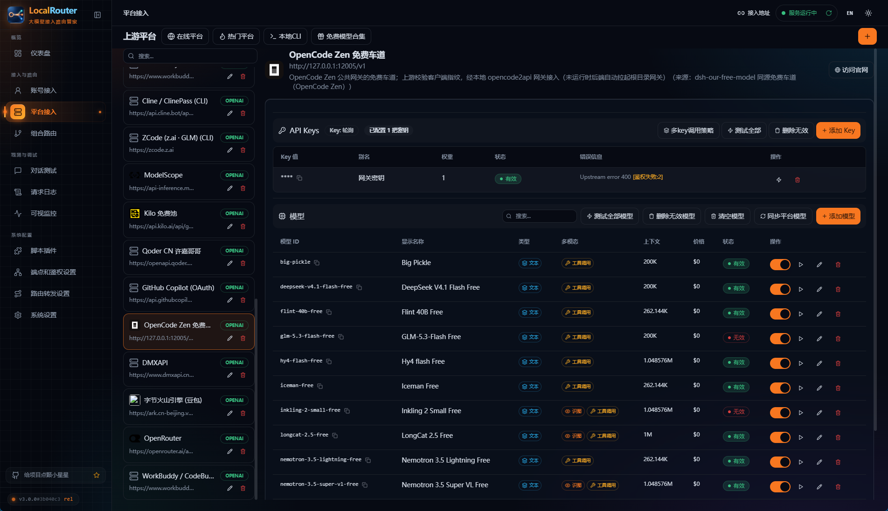
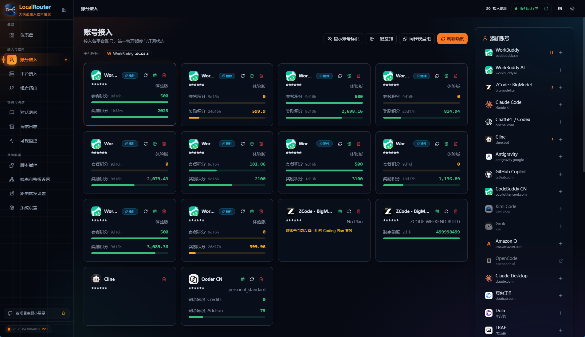
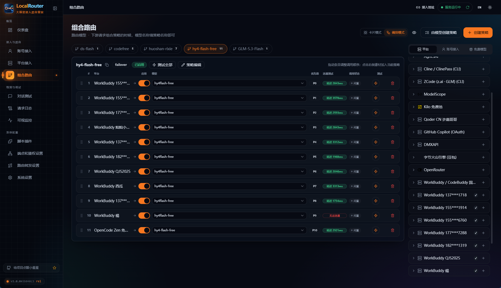
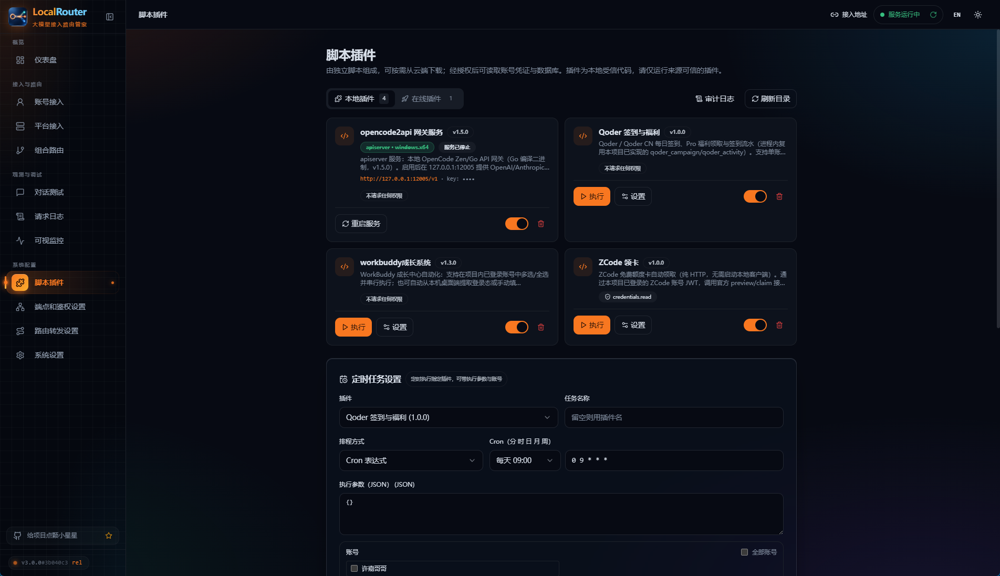
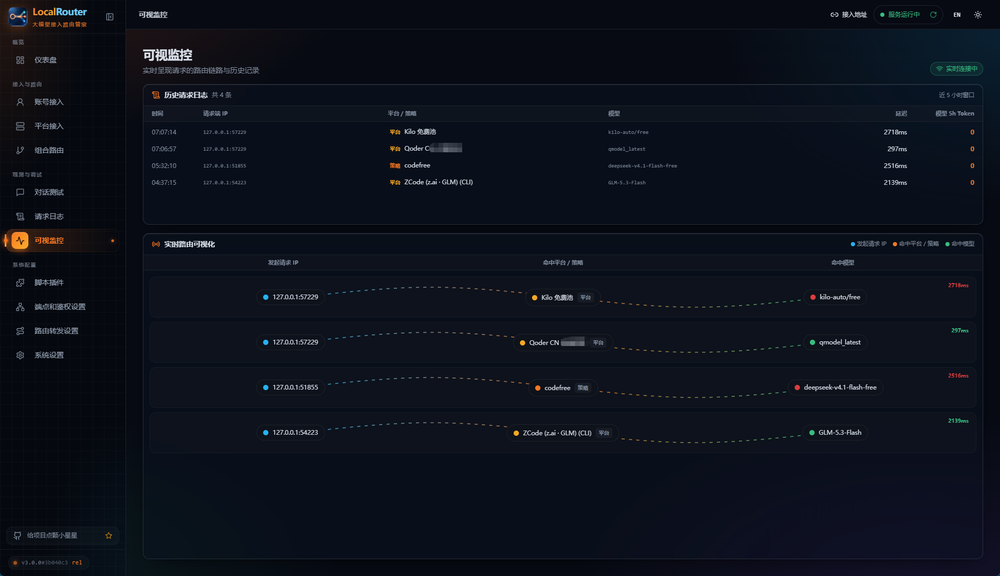

# LocalRouter

<p align="center">
  
</p>

> **Your local API routing manager** — one endpoint for all your LLM APIs.

> **English** | [中文](README_ZH.md)

[](https://python.org)
[](https://fastapi.tiangolo.com)
[](https://react.dev)
[](https://typescriptlang.org)
[](LICENSE)

<p align="center">
  
</p>

---

## The problem it solves

Managing multiple LLM providers is painful: different API formats, billing models and rate limits mean juggling many keys, SDKs and hand-rolled failover logic.

**LocalRouter solves this with a single OpenAI-compatible endpoint** — it unifies 65+ providers, multiple accounts, keys and models behind one local gateway, exposing just `http://localhost:12002/v1`. Any OpenAI SDK client works by changing its `base_url`.

- **Fully local**: config and data stay on your machine; keys are encrypted with Fernet and never relayed through the cloud
- **LAN sharing**: one access point for your whole team or household
- **Open source (MIT)**: desktop installers for Windows / macOS / Linux, plus Docker and source deployment

---

## Screenshots

| Accounts (quotas at a glance) | Providers (platforms / keys / models) |
|:---:|:---:|
|  |  |
| **Composite routes (smart dispatch)** | **Script plugins (extensible)** |
|  |  |
| **Visual logs (trace view)** | |
|  | |

---

## Core features

### 👤 Accounts
Manage third-party accounts across providers (WorkBuddy, CodeBuddy, ZCode, Claude Code, ChatGPT/Codex, Cline, Antigravity, GitHub Copilot, Amazon Q, OpenCode and more), with **live remaining quota / credits**, one-click refresh and network checks. Credentials auto-renew — no repeated logins.

### 🔌 Providers
- Structured upstream management (name, protocol, endpoint, icon) with icon search
- 65+ hot-provider templates and an **online catalog** for on-demand import
- Per-provider key & model management: health checks, bulk testing, and multi-key strategies (round-robin / random / failover / RPM threshold / count threshold)

### 🧭 Composite routes
- 5 load-balancing strategies: **round-robin, weighted, random, failover, priority**
- Combine rules by priority into strategies, resolved by model name
- Automatic failover to backup routes, <1ms local forwarding — clients notice nothing

### 🧩 Script plugins
- Plugins are downloaded on demand from the online catalog, never bundled with the installer
- Service-type plugins (e.g. the opencode2api gateway) auto-start in the background when enabled
- Built-in **scheduled tasks** (cron / interval / once) for recurring jobs such as check-ins, with execution logs

### 📊 Visual logs
- Dashboard: request volume, success rate, latency and token usage, refreshed live
- Visual logs: full request history with call-chain tracing, filterable by provider / strategy / status

### 🛡️ Protocol conversion & endpoints
- Automatic conversion between OpenAI / Anthropic Claude / Google Gemini — any SDK, any model
- Compatible endpoints: `/v1/chat/completions`, `/v1/responses`, `/v1/messages`, `/v1beta/models/...:generateContent`

---

## Quick start

### Desktop app (recommended)

Download the installer for your platform from [Releases](https://github.com/licorxj/QM-LocalRouter/releases):

- **Windows**: `LocalRouter-Setup-x.x.x-x64.exe` (data kept in `%LOCALAPPDATA%\Programs\LocalRouter\data`)
- **macOS**: `LocalRouter-Setup-x.x.x-macos.pkg`
- **Linux**: `apirouter-linux.zip` (extract and run `run.sh`)

After install, open the desktop app — the Web UI and API run at `http://127.0.0.1:12002`.

### From source

Requirements: Python 3.10+ / Node.js 18+

```bash
git clone https://github.com/licorxj/QM-LocalRouter.git
cd QM-LocalRouter

# Bootstrap (venv, deps, database)
cd scripts && python init_db.py && cd ..

# Start via manager script
./scripts/manage.sh start          # Linux/macOS
scripts\manage.bat start           # Windows

# Or manually (two terminals)
# Terminal 1: cd backend && uvicorn app.main:app --host 0.0.0.0 --port 12002
# Terminal 2: cd frontend && npm install && npm run dev
```

Open **http://localhost:12001** (dev) or **http://localhost:12002** (production / desktop).

### First steps

1. Add an account or API Key under **Accounts** or **Providers**
2. Add models — manually or sync them from the upstream in one click
3. Create a strategy with routing rules under **Composite routes**
4. Point your client's `base_url` to `http://localhost:12002/v1` and `model` to the strategy name

---

## Client configuration

| Client | Configuration |
|--------|---------------|
| **OpenAI SDK** | `base_url="http://localhost:12002/v1"`, `api_key="any value"` |
| **ChatBox** | Settings > Custom API > Base URL: `http://localhost:12002/v1` |
| **CherryStudio** | Settings > Add custom API > Base URL: `http://localhost:12002/v1` |
| **LobeChat** | Settings > Add custom model > API URL: `http://localhost:12002/v1` |
| **Open WebUI** | `OPENAI_API_BASE_URL=http://localhost:12002/v1` |
| **Cursor** | Settings > Models > Base URL: `http://localhost:12002/v1` |
| **curl** | See below |

```bash
curl http://localhost:12002/v1/chat/completions \
  -H "Content-Type: application/json" \
  -d '{"model":"my-strategy","messages":[{"role":"user","content":"Hello!"}]}'
```

> `api_key` can be any value; `model` must be a **strategy name**. Management APIs live under `/api/`, with Swagger docs at `http://localhost:12002/docs`.

---

## Tech stack

| Layer | Technology |
|-------|------------|
| Frontend | React 18 + TypeScript + Vite 5 |
| UI | Tailwind CSS 3 + Radix UI (light/dark themes) |
| State | Zustand + TanStack Query 5 |
| Backend | Python 3.10+ / FastAPI / uvicorn (async) |
| Database | SQLite + SQLAlchemy 2.0 (async) |
| Encryption | cryptography (Fernet) |
| Routing kernel | LiteLLM (multi-protocol, lazy provider loading) |
| Packaging | PyInstaller (single-file exe) + Inno Setup (Windows installer) |

---

## Documentation

| Doc | Description |
|-----|-------------|
| [README_ZH.md](README_ZH.md) | 中文文档 |
| [docs/USAGE.md](docs/USAGE.md) | User guide |
| [docs/DEPLOYMENT.md](docs/DEPLOYMENT.md) | Deployment (Docker / VPS / Windows / Linux) |
| [docs/DEVELOPMENT.md](docs/DEVELOPMENT.md) | Developer guide |
| [docs/API.md](docs/API.md) | API reference |
| [docs/DEPENDENCIES.md](docs/DEPENDENCIES.md) | Dependencies & plugin distribution strategy |

---

## License

MIT License
