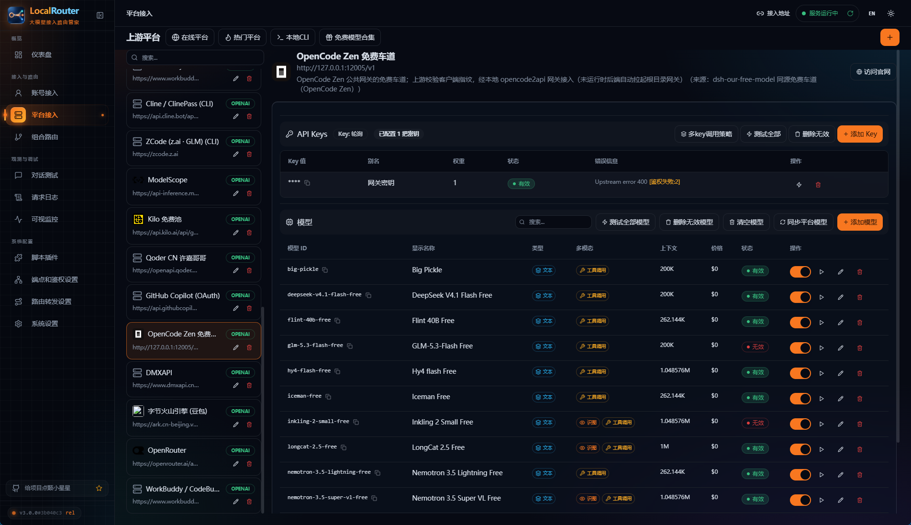
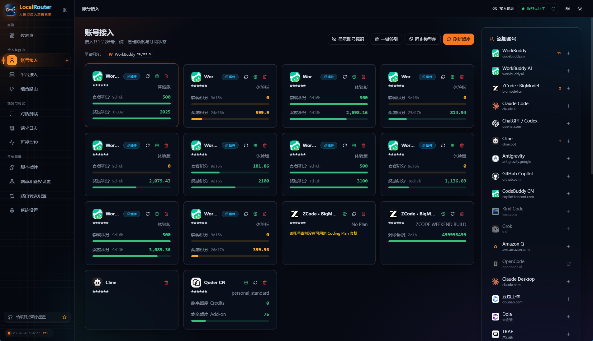
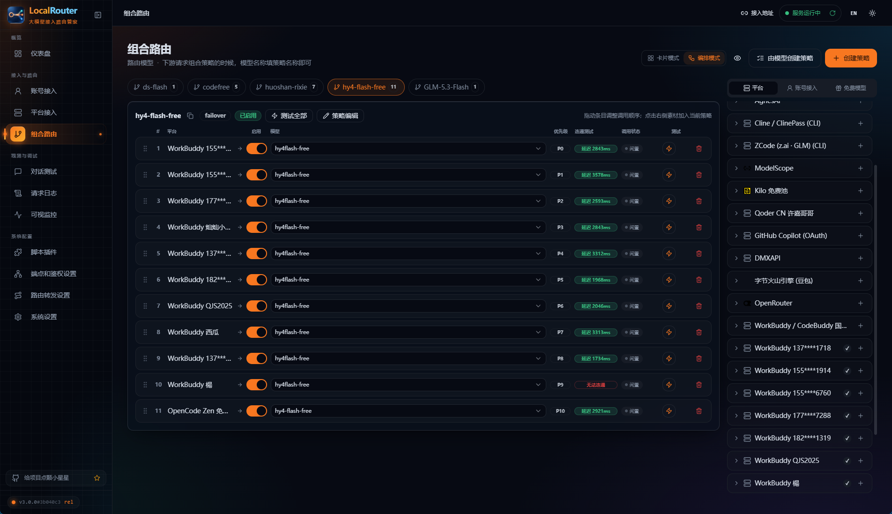
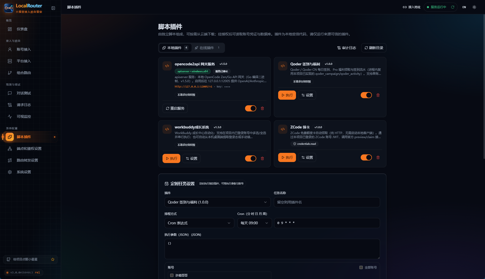
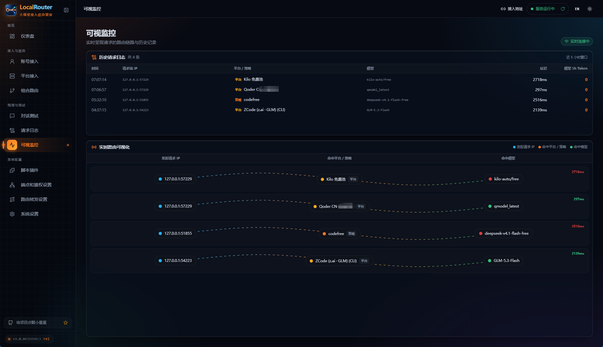

# LocalRouter

<p align="center">
  
</p>

> **你的本地 API 路由管家** — 一个端点，接管所有大模型 API。

> [English](README.md) | **中文**

[](https://python.org)
[](https://fastapi.tiangolo.com)
[](https://react.dev)
[](https://typescriptlang.org)
[](LICENSE)

<p align="center">
  
</p>

---

## 它解决什么问题

管理多个大模型平台很麻烦：每家有不同的 API 格式、计费方式和限流规则，你要维护多套 Key、多个 SDK，还要自己处理故障切换。

**LocalRouter 用一个 OpenAI 兼容端点解决这一切**——把 65+ 平台、多账号、多 Key、多模型统一收进本地网关，对外只暴露一个 `http://localhost:12002/v1`。任何 OpenAI SDK 客户端改个 `base_url` 就能用。

- **纯本地运行**：配置与数据全部存在本机，Key 用 Fernet 加密存储，不经过公网中转
- **局域网共享**：一个接入点，全家设备 / 整个团队共用一份订阅
- **开源 MIT**：Windows / macOS / Linux 桌面安装包齐全，也可 Docker / 源码部署

---

## 界面一览

| 账号接入（多账号额度一目了然） | 平台接入（平台 / Key / 模型一站式） |
|:---:|:---:|
|  |  |
| **组合路由（多策略智能分发）** | **脚本插件（可扩展能力）** |
|  |  |
| **可视化日志（调用链追踪）** | |
|  | |

---

## 核心能力

### 👤 账号接入
统一纳管各平台的第三方账号（WorkBuddy、CodeBuddy、ZCode、Claude Code、ChatGPT/Codex、Cline、Antigravity、GitHub Copilot、Amazon Q、OpenCode 等），**实时展示剩余额度 / 积分**，支持一键刷新与网络检测。账号凭据自动续期，无需反复登录。

### 🔌 平台接入
- 结构化管理上游平台（名称、协议、地址、图标），图标一键搜索
- 65+ 热门平台模板一键添加，**在线平台目录**按需导入
- 每个平台下集中管理 Key 与模型：密钥健康检测、批量测试、多 Key 调用策略（轮询 / 随机 / 故障转移 / RPM 阈值 / 计数阈值）

### 🧭 组合路由
- 5 种负载均衡策略：**轮询、加权、随机、故障转移、优先级**
- 多条规则按优先级组合成策略，按模型名解析并分发
- 上游故障时**自动切换**备用线路，本地转发延迟 <1ms，客户端无感知

### 🧩 脚本插件
- 插件从在线目录**按需下载**，不随安装包分发，保持本体轻量
- 服务型插件（如 opencode2api 网关）启用后自动在后台拉起，提供兼容接口
- 内置**定时任务**（cron / interval / once），可自动执行签到等重复作业，并留有执行日志

### 📊 可视化日志
- 仪表盘：请求量、成功率、延迟、Token 用量，实时刷新
- 可视化日志：完整请求历史 + 调用链追踪，按平台 / 策略 / 状态筛选

### 🛡️ 协议互转与多端点
- OpenAI / Anthropic Claude / Google Gemini 协议自动互转，任意 SDK 调用任意模型
- 提供 `/v1/chat/completions`、`/v1/responses`、`/v1/messages`、`/v1beta/models/...:generateContent` 等兼容端点

---

## 快速开始

### 桌面版（推荐）

从 [Releases](https://github.com/licorxj/QM-LocalRouter/releases) 下载对应平台的安装包：

- **Windows**：`LocalRouter-Setup-x.x.x-x64.exe`（Inno Setup 安装，数据保留在 `%LOCALAPPDATA%\Programs\LocalRouter\data`）
- **macOS**：`LocalRouter-Setup-x.x.x-macos.pkg`
- **Linux**：`apirouter-linux.zip`（解压后运行 `run.sh`）

安装后打开桌面应用，Web UI 与 API 默认在 `http://127.0.0.1:12002`。

### 源码部署

环境要求：Python 3.10+ / Node.js 18+

```bash
git clone https://github.com/licorxj/QM-LocalRouter.git
cd QM-LocalRouter

# 初始化（自动建虚拟环境、装依赖、建数据库）
cd scripts && python init_db.py && cd ..

# 启动：用管理脚本
./scripts/manage.sh start          # Linux/macOS
scripts\manage.bat start           # Windows

# 或手动启动（两个终端）
# 终端 1：cd backend && uvicorn app.main:app --host 0.0.0.0 --port 12002
# 终端 2：cd frontend && npm install && npm run dev
```

浏览器打开 **http://localhost:12001**（开发模式）或 **http://localhost:12002**（生产 / 桌面版）。

### 第一步

1. 进入 **账号接入** 或 **平台接入**，添加你的账号 / API Key
2. 添加模型——可手动录入，或一键从上游同步
3. 进入 **组合路由**，创建策略并添加路由规则
4. 客户端设置 `base_url` 为 `http://localhost:12002/v1`、`model` 为策略名称

---

## 客户端配置

| 客户端 | 配置方式 |
|--------|----------|
| **OpenAI SDK** | `base_url="http://localhost:12002/v1"`, `api_key="任意值"` |
| **ChatBox** | 设置 > 自定义 API > Base URL: `http://localhost:12002/v1` |
| **CherryStudio** | 设置 > 添加自定义 API > Base URL: `http://localhost:12002/v1` |
| **LobeChat** | 设置 > 添加自定义模型 > API URL: `http://localhost:12002/v1` |
| **Open WebUI** | `OPENAI_API_BASE_URL=http://localhost:12002/v1` |
| **Cursor** | 设置 > 模型 > Base URL: `http://localhost:12002/v1` |
| **curl** | 见下方示例 |

```bash
curl http://localhost:12002/v1/chat/completions \
  -H "Content-Type: application/json" \
  -d '{"model":"my-strategy","messages":[{"role":"user","content":"你好！"}]}'
```

> `api_key` 可填任意值；`model` 必须填**策略名称**。管理 API 在 `/api/` 下，Swagger 文档见 `http://localhost:12002/docs`。

---

## 技术栈

| 层 | 技术 |
|----|------|
| 前端 | React 18 + TypeScript + Vite 5 |
| UI | Tailwind CSS 3 + Radix UI（深浅双主题） |
| 状态管理 | Zustand + TanStack Query 5 |
| 后端 | Python 3.10+ / FastAPI / uvicorn（异步） |
| 数据库 | SQLite + SQLAlchemy 2.0（异步） |
| 加密 | cryptography（Fernet） |
| 路由内核 | LiteLLM（多协议适配 / 懒加载提供商） |
| 打包 | PyInstaller（单文件 exe）+ Inno Setup（Windows 安装包） |

---

## 文档

| 文档 | 说明 |
|------|------|
| [README.md](README.md) | English documentation |
| [docs/USAGE_ZH.md](docs/USAGE_ZH.md) | 中文使用教程 |
| [docs/DEPLOYMENT.md](docs/DEPLOYMENT.md) | 部署指南（Docker / VPS / Windows / Linux） |
| [docs/DEVELOPMENT.md](docs/DEVELOPMENT.md) | 开发者文档 |
| [docs/API.md](docs/API.md) | API 参考 |
| [docs/DEPENDENCIES.md](docs/DEPENDENCIES.md) | 依赖清单与插件分发策略 |

---

## 联系与支持

如果这个项目对你有帮助，欢迎联系和交流：

<div align="center">
  <table>
    <tr>
      <td align="center">
        <strong>添加好友 (微信)</strong><br>
        <br>
        <em>扫码添加好友</em>
      </td>
      <td align="center">
        <strong>打赏支持 (微信支付)</strong><br>
        <br>
        <em>扫码支持项目</em>
      </td>
    </tr>
  </table>
</div>

---

## 许可证

MIT License
